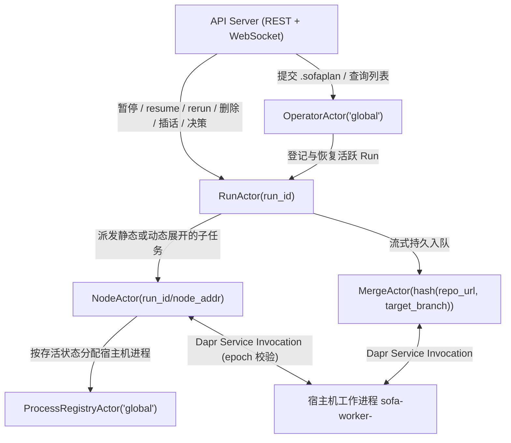

# sofa 分布式架构、运行契约与统一 API 规范（Frozen Draft）

本文档固化经 `/grill-me` 逐分支确认的系统骨架契约，涵盖 **Dapr Actor 拓扑、单机/分布式同构、`golden` 协同、容器与会话工具门禁、跨机检查点防脑裂、串行合并责任边界与 HTTP/WebSocket API 契约**。

---

## 1. 单机与分布式统一底座（100% 绑定 `dapr/go-sdk/actor`）

- **不做自定义本地 Actor 宿主抽象层**：所有编排与状态代码直接基于 `dapr/go-sdk/actor` 编写。
- **单机模式**：自动生成指向用户指定状态文件夹的本地 Dapr 组件配置（如本地文件 / SQLite State Store + 本地 PubSub），拉起/连接本地 `daprd`（slim / standalone 模式）。
- **分布式模式**：多机连接共享 Dapr State Store、PubSub 与 Placement 服务（不强制要求 Kubernetes）。

---

## 2. Dapr Actor 拓扑与身份寻址

| Actor 类型 | Actor ID 规则 | 核心持久状态与职责 |
| :--- | :--- | :--- |
| **`OperatorActor`** | 固定 `"global"` | 维护全量 `run_id` 索引摘要与冷启动恢复入口，不承担单 Run 的高频拓扑锁。 |
| **`RunActor`** | `<run_id>` | 持有不可变 `.sofaplan` 引用、节点状态表、Run 级受管 Git 分支账本与临时 Artifact 账本；通过事件驱动毫秒级短调用与 Reminder 对账推进 DAG；负责 `dynamic_worker` 展开键列表的首次持久化固化。 |
| **`NodeActor`** | `<run_id>/<canonical_node_addr>` | 静态 `worker` 及 `dynamic_worker` 动态展开出的**每一个子任务**各自对应一个独立 `NodeActor`；管理单调递增的 `epoch`、所属 `process_id`、结构化日记流、人工插话队列、检查点序列与 `human_approval` 版本绑定记录。 |
| **`MergeActor`** | `<sha256(repo_url + target_branch)>` | 维护持久化合并请求队列（绝不因正忙而阻塞调用方或丢弃请求）；按目标分支全局串行执行候选树 `rebase` + `gatekeeper` 重测。 |
| **`ProcessRegistryActor`** | 固定 `"global"` | 登记工作进程每次启动生成的 `process_id`、Dapr App ID（`sofa-worker-<process_id>`）与三态健康状态（`HEALTHY` → `SUSPECT` → `DEAD`）。 |

---

## 3. `golden` 在离线 Plan 与分布式 Apply 中的分工

1. **Plan 期（仅在 CLI 本地离线执行）**：
   - `sofa plan` 在本机直接调用 `golden`（`AsHclBlocks` → `InitConfig` → `RunPlan`）完成类型检查、Root 单例推导与无环校验。
   - 输出自包含的 **`.sofaplan` 归档包**（内含冻结的不可变 Plan JSON + 模块静态资源快照如 `skills/`、子模块、随附工具脚本）。**服务端不提供远程建 Plan 接口**。
2. **Apply 期（`RunActor` 非阻塞短调用驱动）**：
   - 服务端接收 `.sofaplan` 存入 `BlobStore` 并创建 `run_id`。
   - `RunActor` **不运行阻塞式的 `golden.RunApply`**；每次在收到节点完成事件或 Reminder 对账时，在毫秒级短调用内：
     1. 按持久状态表找出所有前序依赖已 `SUCCEEDED` 的就绪节点；
     2. 将已完成上游的公开值注入 `hcl.EvalContext`（复用 `golden` 函数表），单步求值延迟表达式（或固化 `dynamic_worker` 的 `for_each` 并派生子 `NodeActor`）；
     3. 异步通知目标 `NodeActor` / `MergeActor` 启动，立即返回释放 Actor 锁。

---

## 4. 宿主机工作进程、容器沙箱与 Session 工具门禁协议

### 4.1 物理与凭据隔离边界
- **宿主机工作进程（`sofa-worker`）**：可信运行时，持有 Git 远端推送凭据、Artifact `BlobStore` 凭据与 Dapr 通信入口；负责从 `BlobStore` 拉取 `.sofaplan` 资源只读挂载为容器的 `${path.module}`，管理项目代码卷以及启动/销毁 Work、Gatekeeper、QC 容器。
- **容器内部**：不可信沙箱边界，按 `writable_paths` 限制项目卷读写范围，其他目录（`/tmp`、`$HOME` 等）容器私有隔离；**绝不持有 Git 推送密钥或 Dapr 访问权，绝不允许调用任何宿主机命令**。

### 4.2 Session 级强类型工具与双层门禁（复刻 `r42` 机制）
- `sofa` 提供的会话协议工具（`sofa_checkpoint`、`sofa_request_decision`、`sofa_pause_for_human`、Artifact 读取工具、QC 问题账本与裁决工具）统一注册为 `copilot-sdk/go` 的内存 `sdk.Tool` Handler，**仅能由 LLM 对话轮次发起 `tool_call` 触发，容器内任何子进程或 `bash` 脚本均无入口调用**。
- 通过 `sdk.SessionHooks.OnPreToolUse`（拦截内置/MCP 工具）+ `sdk.Tool` Handler 包装（拦截自定义/协议工具）实施四条硬约束：
  1. **每次工具调用前查插话**：每次工具执行前及发送新消息前核对 `NodeActor` 是否有新人工日记插话，有则优先注入上下文；若带“回答后等待确认”标记，锁定业务修改工具，要求 Agent 回答后调用 `sofa_pause_for_human` 进入 `WAITING_HUMAN`。
  2. **每满 N 轮强制检查点（`checkpointPending`）**：连续完成 `checkpoint_every_rounds` 轮工具调用后锁死其他工具，拒绝一切非检查点调用直至 `sofa_checkpoint` 提交结构化日记并完成远端检查点落盘。
  3. **交接锁死当前回复（`roundComplete` 边界）**：一旦提交审查、`sofa_request_decision` 或暂停工具被 `Accepted`，立即拒绝本轮回复中的所有后续工具调用（并用 `activeToolCalls` 引用计数确保无并发在途工具），强制模型结束当前回复；若模型未按协议调工具就擅自结束回复，外层 `Runner` 自动发协议修复提示重试（上限 `max_protocol_attempts`）。
  4. **容器内 `gatekeeper` + 冻结式独立 `QC` 容器**：Work 回复干净结束后，工作区冻结；先在容器内执行 `gatekeeper` 命令验真实退出码与干净工作树，通过后再挂载同一只读冻结代码卷启动独立 `QC` 容器；任一未通过均带结构化问题打回 Work Session（超出轮数上限则按显式 `fallback` 退回前序节点或报错）。

---

## 5. 跨机器存储、Epoch 检查点防脑裂与进程存活三态

### 5.1 存储分层
- **Dapr Actor State**：存储所有 Actor 状态机、分支登记账本、检查点元数据、**结构化日记条目**、人工插话与人工决策记录。
- **`BlobStore` 接口**：存储 `.sofaplan` 归档包、非 Git `artifact` 文件/目录归档包以及按需查阅的原始消息流 JSONL（单机默认落盘到状态目录 `blobs/`；分布式支持 S3 兼容对象存储如 MinIO/S3/OSS 或共享目录）。

### 5.2 按 Epoch 隔离的检查点分支与恢复协议
- **防僵尸覆盖（Epoch-Scoped Checkpoint Branch）**：每个执行轮次使用带轮次后缀的独立远端分支（如 `sofa/ckpt/<run_id>/<node_key>/e<epoch>`），且必须**先在 `RunActor` 账本登记成功后再创建推送**（Run 结束或删除时连同所有历史轮次中间分支统一清理，仅保留 `source` 与匹配 `preserve` 的分支）。
- **二阶段保存**：写日记记录当前 SHA → 若有未提交变更则提交并推送到当前 `e<epoch>` 分支 → 若产生了新 SHA 则在日记追加最终 SHA → 确认远端 `e<epoch>` 分支提交、Dapr 持久日记与 `BlobStore` 中非 Git 文件全部一致后，由 `NodeActor`（校验 `epoch` 未过期）标记该检查点完整。
- **恢复对齐**：新轮次 `e<epoch+1>` 在新机器恢复时，沿检查点序列从新到旧核对日记记录的最终 SHA 与远端历史轮次分支提交，找到最近一个完全对齐的完整检查点，以其 SHA 为起点切出 `e<epoch+1>` 分支并加载日记流作为历史记忆继续执行。
- **正式 `work_branch` 发布**：仅当 `gatekeeper`、`qc` 与 `human_approval`（若为 `"required"`，批准必须精确绑定当前最终 `(commit_sha, artifact_ids)`，任何后续改动自动使旧批准失效）全部通过，且经 `NodeActor` 核对当前 `epoch` 有效后，才创建/更新正式受管 `work_branch`。

### 5.3 `ProcessRegistryActor` 进程存活三态
- **`HEALTHY`**：定期收到工作进程心跳。
- **`SUSPECT`（可疑）**：单次通信失败或首次心跳超时 → 暂停向该进程派发新任务，**不立即判定死亡**，由 Reminder 连续主动探测该工作进程的 Dapr 入口。
- **`DEAD`（确认失联）**：连续主动探测跨越宽限期仍失败 → 标记 `DEAD`，通知相关 `NodeActor` 递增 `epoch` 换机从最近完整检查点接管；若旧工作进程稍后恢复通信，发现自身 `process_id` 已失效，立即销毁本地残留旧容器并以新 `process_id` 重新注册。

---

## 6. `MergeActor` 流式合并与“严格源头负责”契约

1. **合入前验证失败（严格源头负责）**：
   - `MergeActor` 从持久队列取出候选分支 `W_i`，基于当前目标分支最新提交 `M_k` 在临时候选树上执行 `git rebase` 并在容器内运行 `merge` 配置的 `gatekeeper` 命令。
   - `MergeActor` **不运行修改代码的 Agent Session**：只要存在 rebase 冲突或 `gatekeeper` 退出码非 0，立即丢弃临时候选树，**将源头 `W_i` 下一轮 `epoch` 的基线升级为当前集成分支最新提交 `M_k`**，附带冲突详情或测试失败日志精准退回给 `W_i` 修复重跑；其他已合入分支保留不动，队列后续分支继续处理。
2. **合入成功后下游失败（向前修复）**：
   - 一旦候选通过验证并推进了目标集成分支指针，严禁回滚集成分支历史；更下游工序发现的问题统一基于最新集成分支创建新提交向前修复。

---

## 7. 统一管理 API（REST JSON + WebSocket）与看板安全契约

CLI、Vue 3 看板与外部系统（如 `The Machine`）共用同一套 API：

### 7.1 核心 REST 端点概要
- **任务生命周期**：
  - `POST /api/v1/runs`：上传自包含 `.sofaplan` 包提交执行（`apply`），返回 `run_id`（无服务端远程建 Plan 接口）。
  - `GET /api/v1/runs` / `GET /api/v1/runs/{run_id}`：查询任务列表、DAG 拓扑状态、分支与输出。
  - `POST /api/v1/runs/{run_id}/pause`：支持 `mode = "planned"`（当前运行中工序继续，不派发新节点）与 `mode = "immediate"`（递增在途节点 `epoch` 立即停止容器并舍弃未保存进度）。
  - `POST /api/v1/runs/{run_id}/resume`：解除手动暂停，或让报错/中断节点从最近完整检查点继续。
  - `DELETE /api/v1/runs/{run_id}`：停止并隔离残留执行，按登记账本清理本 Run 创建的中间 Git 分支与临时 Artifacts（保留 `source` 与 `preserve` 匹配分支）。
- **节点操作、日记插话与人工决策**：
  - `GET /api/v1/runs/{run_id}/nodes/{node_id}`：获取节点轮次历史、检查点列表、结构化日记、分级日志与产物列表。
  - `POST /api/v1/runs/{run_id}/nodes/{node_id}/rerun`：推倒当前节点进度从 `based_source` 从头重跑（递增自身及本 Run 内所有传递下游节点 `epoch` 级联作废待重跑；若该节点产物已合入跨 Run 共享目标分支则返回 `409 Conflict` 拒绝重跑）。
  - `POST /api/v1/runs/{run_id}/nodes/{node_id}/diary-messages`：人类向当前工序日记写入插话（可选 `wait_for_confirmation = true`）。
  - `GET /api/v1/decisions` / `POST /api/v1/decisions/{decision_id}/respond`：查询待处理人工决策卡片并提交决定（选项、自定义答案、追问或要求补充探索；先持久化保存回答再通知 Actor 推进；若 Run 处于手动暂停态，提交回答不自动解除暂停）。
  - `GET /api/v1/runs/{run_id}/artifacts/{artifact_id}/content`：只读读取产物内容。

### 7.2 实时流（WebSocket）
- `GET /api/v1/ws`（支持按 `run_id` / 全局订阅过滤）：后端订阅 Dapr PubSub 事件流，向看板与 `sofa apply` 客户端实时推送 Run/Node 状态迁移、分级执行日志、日记更新及新增人工决策卡片通知；所有状态变更控制命令仍统一走上述幂等 REST 接口。

### 7.3 Agent 生成 HTML 原型的强安全隔离
- 看板渲染 Agent 生成的 HTML 材料时，预览端点必须下发严格 `Content-Security-Policy` 响应头，且前端必须置于**不带 `allow-same-origin`** 的 `<iframe sandbox="allow-scripts">` 中（强制浏览器赋予不透明 `null` 源），从浏览器同源策略层彻底阻断其读取看板凭据、访问父窗口 DOM 或代替人类调用决策 API。
